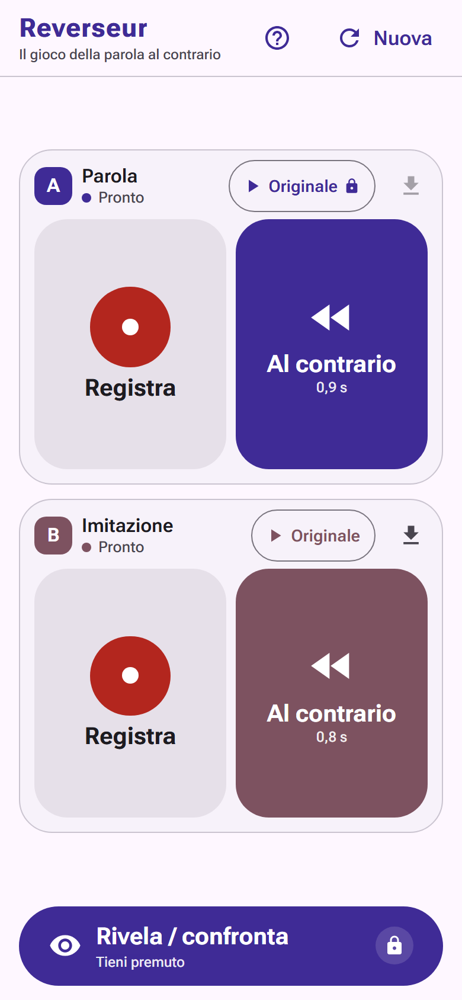

# Reverseur

Il gioco della parola al contrario: registra, inverti, imita, indovina.

**Gioca subito:** <https://burzi.eu/reverseur/> (anche su <https://burzino.github.io/reverseur/>)



## Come si gioca

1. **Giocatore A** registra una parola o una frase (l'originale).
2. **Giocatore B** ascolta la registrazione **al contrario**.
3. **Giocatore B** registra la sua imitazione di quello che ha sentito.
4. L'app riproduce **al contrario** l'imitazione di B: se l'imitazione è buona si sente la parola originale, e B prova a indovinarla.
5. Alla fine si ascolta l'originale di A per confrontare.

"Ascolta originale" di A e "Rivela" svelano la soluzione, quindi vanno **tenuti premuti per almeno 200 ms** (anche `Spazio`/`Invio` da tastiera). Un tocco accidentale non rovina la partita.

## Caratteristiche

- **Offline e installabile**: è una PWA. Dopo la prima visita funziona senza rete e si aggiunge alla schermata Home.
- **Taglio del silenzio** all'inizio e alla fine, così il contrario parte subito.
- **Normalizzazione a −1 dBFS** e fade di 5 ms: le due voci hanno lo stesso volume, senza click.
- **Privacy**: niente account, backend o analytics. L'audio non lascia mai il dispositivo.
- Pulsanti grandi, pensati per usare il telefono con una mano sola.

## Compatibilità

| Browser | Stato | Limiti noti |
| --- | --- | --- |
| Chrome Android | Supportato | — |
| Safari iOS ≥ 14.3 | Supportato | Registra in `audio/mp4`. L'audio parte solo dopo un tocco. Con il telefono in modalità silenziosa la riproduzione può essere muta. |
| Chrome desktop | Supportato | — |
| Firefox desktop | Supportato | Registra in `audio/webm` (Opus). |
| Safari iOS < 14.3 | Non supportato | Manca `MediaRecorder`. |

Serve il permesso per il microfono, e la pagina deve essere servita in HTTPS (o da `localhost`).

## Sviluppo

Stack: Svelte 5, TypeScript, Vite, vite-plugin-pwa. Serve Node 24. Tutti i comandi vanno lanciati da `web/`:

```sh
cd web
npm ci
npm run dev        # server di sviluppo
npm run check      # svelte-check (tipi)
npm run build      # build di produzione in web/dist, base /reverseur/
npm run preview    # serve la build
```

Per un dominio servito dalla radice: `BASE_PATH=/ npm run build`.

## Test

```sh
npm test                               # unit test Vitest (funzioni audio pure)
npx playwright install chromium        # una volta sola
npm run test:e2e                       # E2E Playwright (chromium e mobile-chromium)
```

Gli E2E girano sulla build di produzione sotto `/reverseur/`. Il microfono è finto: Chromium riproduce `web/tests/fixtures/word.wav`. WebKit non ha un microfono finto, quindi non è in CI: su Safari i test si fanno a mano su un dispositivo reale.

CI (GitHub Actions):

- `test.yml`: unit ed E2E a ogni push e pull request.
- `pages.yml`: build e deploy su GitHub Pages a ogni push su `main`.

## Struttura

```
web/
├── src/
│   ├── audio/      # AudioContext, inversione, trim, normalizzazione, registrazione
│   └── ui/         # componenti Svelte e pulsante a pressione prolungata
├── public/         # icone PWA
├── tests/e2e/      # test Playwright
└── tests/fixtures/ # word.wav per il microfono finto
docs/
├── DECISIONS.md    # trade-off e scelte tecniche
└── INTERFACES.md   # contratto tra i moduli
.github/workflows/  # test.yml, pages.yml
```

## Licenza

[MIT](LICENSE) © 2026 burzino
